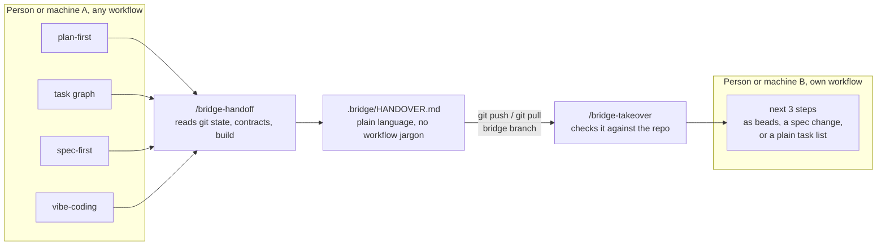

# Agent Skills

**Agent Skills is a set of installable skills for AI coding agents that hand work over through Git: between people, timezones, machines, AI tools, and ways of working.** The first pack, `bridge`, writes a branch's working context (goal, decisions, open questions, next steps) into one committed file, `.bridge/HANDOVER.md`, so whoever continues the branch can pick it up with any AI tool or none.

Teams rarely work the same way. These skills do not ask anyone to switch framework or tooling: **everyone keeps their own way of working**, and the work still moves between them. Each skill uses the open `SKILL.md` format.

## Quick start

```bash
git clone --branch v0.1.1 https://github.com/n9hat/agent-skills.git ~/agent-skills
cd /path/to/your/project
node ~/agent-skills/install.js bridge
```

Then, at the end of a session, run `/bridge-handoff` and push. On the next machine, or for the next person: `git pull`, then `/bridge-takeover`. Needs Git 2.23+ and Node.js 16.7+ (or bash and jq with `install.sh`); see [Installation](#installation).

## Contents

- [Git as a brain-state cache](#git-as-a-brain-state-cache)
- [How it works](#how-it-works)
- [Scenarios](#scenarios)
- [Works with your workflow](#works-with-your-workflow)
- [Packs](#packs)
- [Installation](#installation)
  - [Packs from other repositories](#packs-from-other-repositories)
- [FAQ](#faq)
- [Repository layout](#repository-layout)
- [Adding a pack](#adding-a-pack)
- [Tested so far](#tested-so-far)
- [Testing](#testing)
- [License](#license)

## Git as a brain-state cache

Git already carries the code. What it does not carry is the context around it: why you chose this approach, what you tried and rejected, what you were about to do next. That lives in your head, or in an AI chat on one laptop.

The bridge treats Git as a **temporary brain-state cache**. `/bridge-handoff` writes that context into `.bridge/HANDOVER.md` on a short-lived bridge branch; `/bridge-takeover` reads it back on the other side, checks it against the repository, and proposes the next steps. The cache is deliberately temporary: it lives only on the bridge branch and never reaches your main branch, so stale context cannot mislead anyone later.

That makes three kinds of hot-swap possible without losing momentum:

- **Hardware:** from the office desktop to the laptop on the couch, without trying to remember where you were.
- **People:** from a developer in one timezone to a colleague in another, or to someone covering while a colleague is away.
- **Ways of working and tools:** from a structured, plan-first session to an exploratory vibe-coding one, or from one AI tool to another, without the second session undoing the first.

## How it works



The handover is the common language: each side's workflow-specific state (plan files, bead trackers, spec folders, chat history) is written down in plain words with file paths, and restated in the reader's own workflow on the other side. The [bridge README](packs/bridge/README.md#how-it-works) has the full steps.

## Scenarios

| Scenario | What happens | Details |
|---|---|---|
| **Timezone handoffs (follow-the-sun)** | Europe finishes for the day; the Americas or Asia-Pacific continue the same branch, with the decisions and their reasons, and open questions answered asynchronously. | [Timezone handoffs](packs/bridge/README.md#1-timezone-handoffs) |
| **Emergency takeovers: away (sick-leave)** | A developer is suddenly away mid-feature. A teammate runs `/bridge-takeover`; with no handover, it rebuilds the intent from commits, diffs, and references, and labels everything it inferred. | [Emergency takeovers](packs/bridge/README.md#2-emergency-takeovers-away-sick-leave) |
| **One developer, several devices** | Office desktop to home laptop and back, every day, on the same bridge branch. Your AI chat stays on the first machine; the handover travels with the code. | [Multi-device switching](packs/bridge/README.md#3-single-developer-multi-device-switching) |
| **Mixed workflows on one team** | A branch started under one workflow is continued under another, without either person learning the other's tooling. | [Mixed workflows](packs/bridge/README.md#4-mixed-workflows-on-one-team) |
| **Vibe-coding alongside AI workflows** | The handover is ordinary Markdown, so a person without any AI tool can write or read it. | [Vibe-coding](packs/bridge/README.md#5-human-vibe-coding-alongside-ai-workflows) |

## Works with your workflow

The bridge sits next to the workflow a person already uses; it does not replace it. `/bridge-takeover` is designed to restate the next steps in the reader's own style:

| Workflow style | For example | What a takeover gives you |
|---|---|---|
| Plan-first skill pack | [pstack](https://github.com/cursor/plugins/tree/main/pstack/skills) | the next three steps, as tasks for your plan |
| Task graph of beads | [Agentic Coding Flywheel](https://github.com/Dicklesworthstone/agentic_coding_flywheel_setup) | the next three steps, as beads |
| Specs before code | [Spec Kit](https://github.com/github/spec-kit) | the next three steps, starting with a spec change |
| Personal skill collection | [mattpocock/skills](https://github.com/mattpocock/skills) | the next three steps, as tasks |
| Vibe-coding by hand, with or without AI | none | the next three steps, as a plain task list |

If the takeover cannot tell which workflow you use, it asks. This project is not affiliated with any of the projects named here. Which tools and platforms have been run so far is listed under [Tested so far](#tested-so-far).

## Packs

Skills ship in **packs**: small, self-contained sets of skills that belong together.

| Pack | Skills | What it does |
|---|---|---|
| [`bridge`](packs/bridge/README.md) | `bridge-handoff`, `bridge-takeover` | Passes a branch's working context to another person, timezone, or machine through Git, with any AI tool or none |

## Installation

Clone this repository once, then install the packs you want from inside the project you want to equip. You need Git 2.23 or later.

```bash
git clone --branch v0.1.1 https://github.com/n9hat/agent-skills.git ~/agent-skills

cd /path/to/your/project
bash ~/agent-skills/install.sh bridge          # needs bash (and jq for some packs)
# or
node ~/agent-skills/install.js bridge          # needs Node.js 16.7 or later
```

| Option | Effect |
|---|---|
| `PACK...` | Install these packs |
| `--all` | Install every pack found |
| `--list` | List the packs found, then exit |
| `--packs-dir DIR` | Also look for packs in `DIR`; repeat it for several directories |
| `--target DIR` | Install into `DIR` instead of the current directory |
| `--no-hook` | Skip startup hooks that a pack would add |

The installer copies each pack's skills into `.agents/skills/` (read by Codex, Copilot, and Gemini CLI, according to their documentation) and `.claude/skills/` (read by Claude Code), then runs the pack's own installer, if it has one, for anything else the pack needs. It is safe to run again. Every pack name is checked before anything is written.

`--branch v0.1.1` pins the tested release; [CHANGELOG.md](CHANGELOG.md) lists what each release contains. To upgrade later, check out the new tag, then run the installer again in each project; until you do, a project keeps the version it has:

```bash
git -C ~/agent-skills fetch --tags && git -C ~/agent-skills checkout <new tag>
```

Commit the installed files so everyone who clones the project gets the skills. Agents load skills when a session starts, so start a new session after installing.

**Skills are installed per project.** A tool finds them through the folder a session is opened in, so open the project folder itself. A session opened at a parent folder, such as `~/projects/`, does not see the skills of the projects inside it. A personal install (`--user`) that works in every project is coming soon.

### Packs from other repositories

`--packs-dir` installs packs that live somewhere else, for example a private repository you share only with a team or course:

```bash
git clone git@github.com:<you>/<private-skills>.git ~/private-skills
bash ~/agent-skills/install.sh --packs-dir ~/private-skills/packs <pack>
```

The other repository only needs the same `packs/<name>/skills/<skill>/SKILL.md` layout. If two directories contain a pack with the same name, the first one wins, and this repository's `packs/` always comes first.

## FAQ

### How do I hand a Claude Code session over to a teammate?

Work on a bridge branch (`git switch -c bridge/<topic> origin/main`). At the end of the session, run `/bridge-handoff`, commit the handover on its own, and push. Your teammate pulls the branch and runs `/bridge-takeover`. See [the back-and-forth loop](packs/bridge/README.md#the-back-and-forth-loop).

### How do I continue my own work on another machine?

The same way: hand off and push on the first machine, pull and take over on the second. The handover carries what you had decided and what you were about to do; your AI chat history stays behind.

### What if someone is away and left no handover?

Run `/bridge-takeover` anyway. It rebuilds the intent from recent commits, diffs, the branch name, and references, and labels everything it inferred. Only pushed work can be taken over.

### Does the handover end up in my main branch?

No. It lives only on the bridge branch. When the work is finished, `promote.sh` copies the net change onto a clean branch without `.bridge/`; see [Merging the finished work](packs/bridge/README.md#merging-the-finished-work).

### Can several sessions share one bridge branch?

They share one handover file, so hand off one at a time, or give each area its own bridge branch, for example `bridge/backend`, `bridge/ui`, and `bridge/mobile`.

### How is this different from a "handoff" skill that summarises the chat?

A chat-summary handoff helps a fresh agent continue on the same machine. The bridge records the branch's state in Git, checks it on the other side, and reaches another person or machine. The two can be used together.

### Which AI tools does it work with?

The skills use the open `SKILL.md` format, and the installer writes them where Claude Code, Codex, Copilot, and Gemini CLI look for them. See [Tested so far](#tested-so-far) for what has been run, and the [tool support table](packs/bridge/README.md#tool-support).

## Repository layout

```
install.sh                       # hub installer (bash)
install.js                       # hub installer (Node.js, same behaviour)
llms.txt                         # short summary of this repository for AI tools
packs/
  bridge/
    README.md                    # what the pack does and how to use it
    install.sh, install.js       # pack extras: AGENTS.md note, Claude Code hook
    templates/                   # files the pack extras write
    skills/
      bridge-handoff/SKILL.md
      bridge-takeover/SKILL.md, scripts/promote.sh
    tests/run.sh                 # tests for this pack
tests/
  installer.sh                   # tests for the hub installers
  run-all.sh                     # runs every test above
```

## Adding a pack

1. Create `packs/<pack>/skills/<skill>/SKILL.md` for each skill, with `name: <skill>` (matching the folder) and a precise `description` that says when to use it.
2. Add `packs/<pack>/README.md`.
3. If the pack needs more than its skills (a note in `AGENTS.md`, a hook), add **both** `install.sh` and `install.js` to the pack. They receive `--target DIR` and, if the user passed it, `--no-hook`.
4. Add `packs/<pack>/tests/run.sh` and make `bash tests/run-all.sh` pass.
5. Add the pack to the table above, and to `llms.txt`.

A pack can also carry its own `LICENSE` if its terms differ from this repository's.

## Tested so far

- **Run hands-on:** Claude Code on Linux and WSL Ubuntu, and the automated tests below on Linux.
- **Not yet run:** Codex, Copilot, Gemini CLI, and other tools; macOS; Windows outside WSL.

Each pack's README lists exactly what was run, for example the [bridge](packs/bridge/README.md#tested-so-far). Reports from other tools and platforms are welcome as issues.

## Testing

```bash
bash tests/run-all.sh      # needs bash, node and jq
```

## License

[MIT](LICENSE) © 2026 Narayana Bhat
